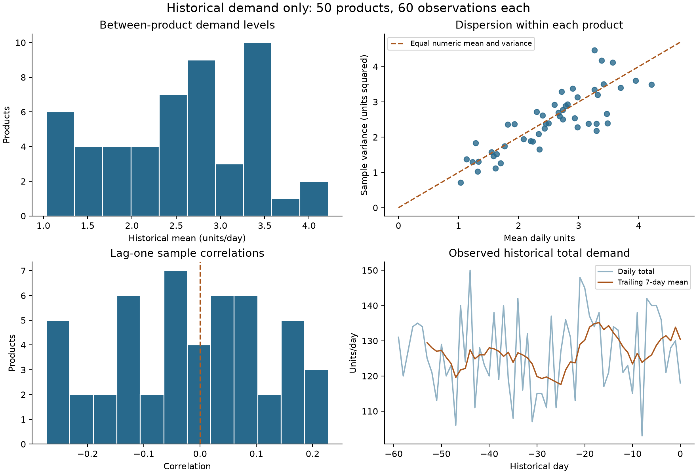
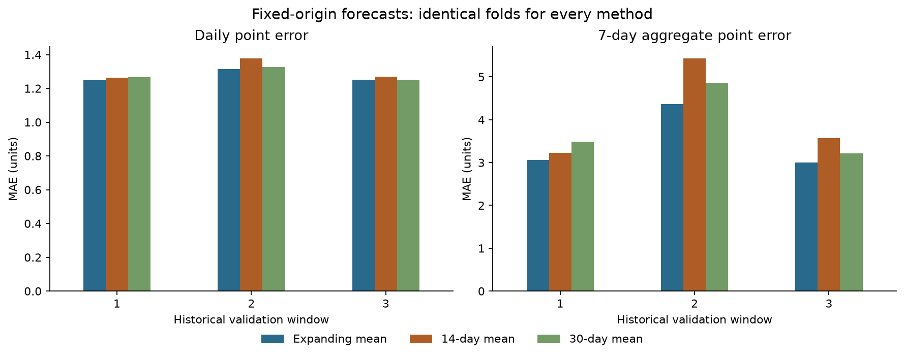

# Historical demand analysis and forecasting (Phase 3B)

## Scientific objective and information boundary

Compare three transparent expected-demand forecasts using observed customer
demand, not knowledge of the synthetic generator. Model names and windows were
specified before scoring. The analysis reads only
`data/raw/historical_daily_demand.csv`: 50 products, 60 observations each, days
-59 through 0. It does not read the catalog, researcher diagnostics, latent
rates, or the evaluation-demand CSV. Days 1-30 are not used for EDA, fitting,
scoring, or model selection. Existing generator/simulator tests remain separate
correctness checks, not information sources for forecasting decisions.

Implemented: point forecasts, historical rolling-origin comparison, descriptive
EDA, and an optional separately scored Poisson count candidate. Purchasing rules,
optimization, and an AI agent remain future work. No purchasing performance is
inferred from these forecast scores.

## Historical exploratory evidence

Descriptives use each product's 60 observations, sample variance with denominator
59, sample standard deviation, fraction of zero-demand days, variance/mean ratio,
lag-one Pearson correlation between adjacent observations, and first/second
30-day means. Undefined ratios or correlations for all-zero/constant series
remain missing rather than receiving invented values.

| Product-level statistic | Across-product mean | Minimum | Median | Maximum |
| --- | --- | --- | --- | --- |
| Mean daily demand (units/day) | 2.5310 | 1.0333 | 2.6333 | 4.2167 |
| Sample variance (units squared) | 2.4410 | 0.7107 | 2.3884 | 4.4701 |
| Sample standard deviation (units) | 1.5371 | 0.8431 | 1.5455 | 2.1143 |
| Zero-demand fraction | 0.1027 | 0 | 0.0667 | 0.3667 |
| Variance/mean ratio | 0.9704 | 0.6605 | 0.9660 | 1.4288 |
| Lag-one correlation | -0.0148 | -0.2732 | -0.0052 | 0.2276 |

Products differ substantially in levels and zero frequency. Twenty-one products
have a sample variance/mean ratio above one; none exceeds 1.5. A ratio above one
is a descriptive indication of overdispersion relative to a Poisson reference,
not a significance test. Finite samples can fall above or below one even when
the population ratio equals one. Pooling products would mix different demand
levels and distort this within-product diagnostic.

The first 30 days average 2.500 units/product/day and the second 30 average
2.562. Product-level changes range from -0.5333 to +0.7667 units/day. Three
lag-one correlations have magnitude above 0.25, all negative; no multiple-testing
adjustment or formal trend/stationarity test was performed. Aggregate fluctuations
and weak average correlation provide no compelling descriptive evidence of a
common trend or persistent lag-one dependence, but do not rule out product-specific
patterns, seasonality, or regime changes. Sixty days is a short diagnostic window.



On this observed evidence, a stationary Poisson count model is a plausible
candidate to assess, not an established correct model. Equal mean/variance and
small lag-one correlations alone do not prove independence or a Poisson marginal
distribution. No generator assumptions were used to reach this conclusion.

## Point forecasting methods

Let the decision date be $t$, requested horizon be $H$ days, and $y_{i,s}$ be
observed units for product $i$ on day $s<t$. With $n_t$ observed days, the expanding
mean predicts a constant expected daily count across the forecast horizon:

$$
\hat{m}^{\mathrm{exp}}_{i,t}=\frac{1}{n_t}\sum_{s<t}y_{i,s}.
$$

For a trailing window $w$ equal to 14 or 30 days:

$$
\hat{m}^{(w)}_{i,t}=\frac{1}{w}\sum_{s=t-w}^{t-1}y_{i,s}.
$$

The daily forecast for every future offset $j=0,\ldots,H-1$ is the fitted mean;
expected cumulative demand in units is

$$
\hat{M}_{i,t,H}=H\hat{m}_{i,t}.
$$

For a fitted daily mean of 2.5 units, a seven-day total forecast is 17.5 units.
Fractional expected quantities are intentional, not purchasing quantities to be
rounded here. All means are nonnegative because observed demand is nonnegative.
No distribution, quantile, service probability, or interval follows automatically
from a point forecast. A moving average's shorter memory can adapt faster but
also uses fewer observations and may increase estimation noise.

## Forecasting interface

```python
from adaptive_decision_agent.forecasting import MeanForecaster

# history contains only day, product_id, demand, through decision_day - 1.
result = MeanForecaster(window_days=14).predict(
    history, decision_day=1, horizon=7
)
daily = result.daily       # day, product_id, expected_demand
totals = result.cumulative # product_id, horizon, expected_cumulative_demand
```

Use `window_days=None` for the expanding mean and 30 for the 30-day mean. The
interface accepts complete consecutive product/day observations ending exactly
one day before the decision. Current/future rows are rejected, not silently
filtered. Empty history, missing dates/products, duplicate pairs, negative,
fractional/nonfinite demand, and invalid horizons raise `ValueError`. Fourteen-
and thirty-day models require their full windows; there is no silent fallback.
An expanding mean requires at least one day. Extra columns, including hidden
rate parameters, are rejected. Functions do no file I/O and do not import the
data generator, optimization, or agent packages.

Future purchasing code may call this API with `observation.demand_history` and
`observation.day`; no purchasing policy is added here. The caller must supply
legitimately observed data. This API is not a security sandbox for arbitrary
code with access to external files or future-data closures.

## Rolling-origin validation

All development uses the same three historical folds for every method:

| Window | Training dates | Training days | Validation dates | Validation days |
| --- | --- | --- | --- | --- |
| 1 | -59 through -21 | 39 | -20 through -14 | 7 |
| 2 | -59 through -14 | 46 | -13 through -7 | 7 |
| 3 | -59 through -7 | 53 | -6 through 0 | 7 |

Training always precedes validation; holdout windows do not overlap. The outer
training window expands, while moving averages use only their last 14 or 30
training observations. One seven-day forecast is fitted at each origin and held
fixed throughout that window: no same-fold daily updating or actual-value
feedback. Earlier validation observations legitimately enter later training
windows after they have occurred.

`rolling_validate` rejects input containing evaluation dates or anything other
than the complete -59 through 0 historical panel. Tests change holdout demand
and verify that the corresponding forecasts remain identical. Later-fold forecasts
may change once altered observations have become legitimate training history.

Full-history EDA uses all 60 historical days, including the development holdouts.
It is descriptive development analysis only: its means, dispersion estimates,
correlations, and apparent patterns are not passed into fold models to tune
windows, weights, transformations, or parameters. The three registered methods
and 14/30-day windows are fixed; each fitted mean is calculated exclusively from
that fold's training observations. Optional Poisson scoring changes only the
reported scores, not the point forecasts or their fitted values.
Therefore the displayed scores are development-validation results, not an
independent confirmatory assessment after model selection. Future claims require
the reserved evaluation period and preferably additional scenarios.

## Evaluation metrics

For $N$ matched observations, actual count $y_k$, predicted expected count $f_k$,
and error $e_k=f_k-y_k$:

$$
\mathrm{MAE}=\frac{1}{N}\sum_k|e_k|,\qquad
\mathrm{RMSE}=\sqrt{\frac{1}{N}\sum_k e_k^2},\qquad
\mathrm{Bias}=\frac{1}{N}\sum_k e_k.
$$

All point metrics have units of demand: units per daily observation or units per
seven-day total. Positive bias means overprediction. Scores are pooled over
products and windows, not averaged RMSE values. Each model has 1,050 daily
holdouts and 150 product-week totals. Equal observation counts give each product
and fold equal weight; percentage or cost weighting is not used. Per-product
and per-window summaries are exported as well.

Daily MAE is calculated from daily errors. Weekly MAE is calculated after summing
predicted and actual demand within each product/window. Weekly MAE is not seven
times daily MAE, because signed daily errors can cancel within a week.

### Separate Poisson candidate

Only with `evaluate_poisson=True` (CLI `--poisson-scores`), interpret $f_k$ as a
plug-in Poisson mean. Mean deviance and negative log-likelihood (NLL) are

$$
\overline{D}=\frac{2}{N}\sum_k\left[y_k\log(y_k/f_k)-y_k+f_k\right],
\qquad
\overline{\mathrm{NLL}}=\frac{1}{N}\sum_k\left[f_k-y_k\log f_k+\log(y_k!)\right].
$$

For zero actual counts the logarithmic deviance term is zero. A zero mean with
zero actual demand scores zero; a zero mean with positive demand has infinite
loss. No epsilon smoothing is hidden. Observed counts must be integers. Lower
scores are better only under this stated candidate distribution.

The weekly Poisson interpretation additionally assumes independent daily counts
with the fitted mean, so the weekly mean is seven times the daily mean. These
plug-in scores omit uncertainty in estimating that mean. They do not provide
interval coverage or prove probabilistic calibration; daily and weekly score
magnitudes should not be compared as if they were the same predictive task.

## Verified historical results

These results use only the existing historical CSV, with Python 3.11.18, NumPy
2.4.6, pandas 3.1.1, and Matplotlib 3.11.2. No evaluation-period forecast error
or inventory strategy performance was calculated for this phase.

| Model | Daily MAE | Daily RMSE | Daily bias | Weekly MAE | Weekly RMSE | Weekly bias |
| --- | --- | --- | --- | --- | --- | --- |
| Expanding mean | 1.27135 | 1.60362 | -0.06919 | 3.47511 | 4.46851 | -0.48432 |
| 14-day mean | 1.30279 | 1.64539 | -0.02714 | 4.07667 | 5.15930 | -0.19000 |
| 30-day mean | 1.28048 | 1.61937 | -0.07787 | 3.85578 | 4.73869 | -0.54511 |

| Window | Model | Daily MAE | Daily RMSE | Daily bias | Weekly MAE | Weekly RMSE | Weekly bias |
| --- | --- | --- | --- | --- | --- | --- | --- |
| 1 | Expanding | 1.24784 | 1.55985 | -0.14366 | 3.06308 | 3.99301 | -1.00564 |
| 1 | 14-day | 1.26265 | 1.57347 | -0.15857 | 3.23000 | 4.24676 | -1.11000 |
| 1 | 30-day | 1.26733 | 1.57738 | -0.15305 | 3.48467 | 4.31722 | -1.07133 |
| 2 | Expanding | 1.31484 | 1.64216 | 0.02391 | 4.36565 | 5.34577 | 0.16739 |
| 2 | 14-day | 1.37735 | 1.72263 | 0.11286 | 5.43000 | 6.46877 | 0.79000 |
| 2 | 30-day | 1.32562 | 1.66580 | 0.01533 | 4.86733 | 5.69298 | 0.10733 |
| 3 | Expanding | 1.25137 | 1.60777 | -0.08782 | 2.99660 | 3.92192 | -0.61472 |
| 3 | 14-day | 1.26837 | 1.63667 | -0.03571 | 3.57000 | 4.46934 | -0.25000 |
| 3 | 30-day | 1.24848 | 1.61370 | -0.09590 | 3.21533 | 4.03944 | -0.67133 |



The expanding mean has the lowest pooled MAE and RMSE at both scales and the
lowest weekly MAE in every fold. The 30-day mean slightly improves daily MAE
in window 3. Across per-product weekly MAE, expanding is lowest for 31 products,
30-day for 10, and 14-day for 9. Do not assume the pooled winner is best for
every product. Window 2 is harder for all methods despite more training data.
Its higher errors cannot be attributed to trend or a regime change from these
three windows alone.

| Poisson candidate mean supplied by | Daily deviance | Daily NLL | Weekly deviance | Weekly NLL |
| --- | --- | --- | --- | --- |
| Expanding mean | 1.12071 | 1.82719 | 1.21551 | 2.93985 |
| 14-day mean | 1.17087 | 1.85228 | 1.56667 | 3.11543 |
| 30-day mean | 1.14284 | 1.83826 | 1.37043 | 3.01731 |

These separate scores also favor the expanding plug-in candidate in this sample.
This agreement is not an independent proof of calibrated probabilities or a
reason to infer the generator's true distribution. No uncertainty interval,
formal stationarity test, multiple-comparison correction, or significance test
has been performed.

## Reproduction and artifacts

Install optional plotting dependencies in the project environment:

```powershell
& 'C:\Anaconda3\envs\adaptive-agent\python.exe' -m pip install -e ".[dev,analysis]"
& 'C:\Anaconda3\envs\adaptive-agent\python.exe' -m adaptive_decision_agent.forecasting.analysis --history data/raw/historical_daily_demand.csv --output-dir outputs/demand_analysis --figure-dir docs/figures --poisson-scores
```

The command exports product descriptives, daily/weekly holdout predictions,
overall/window/product point metrics, and optional Poisson scores to
`outputs/demand_analysis/` (Git-ignored). Two PNG figures live in `docs/figures/`
for documentation review. Inputs are never rewritten. The core forecasting API
needs only NumPy and pandas; Matplotlib is an optional analysis dependency.

## Interpretation and limitations

The expanding mean is accepted as the provisional forecasting baseline, retaining the
moving averages for comparison. This preference follows observed historical
errors, not knowledge that the business was synthetically generated in a
particular way. Final evaluation should freeze choices before inspecting days
1-30. That evaluation has not been run here.

Only 21 historical holdout days and three origins are available. Training windows
overlap, and daily errors within a product/week are dependent; treating all
1,050 errors as independent replicates would exaggerate evidence. One historical
dataset cannot establish generalization, optimality, or superiority under drift.
An uncertainty analysis with additional independent scenarios and careful paired
comparisons is future work. Full demand observability is also an assumption;
sales censored by stockouts would require different handling.

All three methods forecast expected demand, whereas MAE is minimized by a
conditional median and RMSE by a conditional mean. A ranking depends on the
loss function; inventory decisions ultimately need their own service/cost
evaluation. Shorter-window noise, unobserved seasonality, heterogeneous products,
parameter uncertainty, and repeated model selection remain methodological risks.
